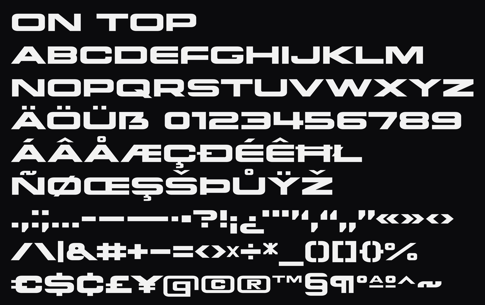

# On Top

A wide, heavy display typeface drawn from the ON TOP logo of [@lrkqz](https://github.com/lrkqz). The
logo holds four letters, O, N, T and P; every other glyph is designed in their logic, from
measurements taken off the logo, and drawn as vectors in code. No outline comes from another font.



**Kurz auf Deutsch:** On Top ist die Schrift von @lrkqz, gezeichnet aus seinem ON-TOP-Logo. Sie steht
unter der SIL Open Font License 1.1 (siehe [OFL.txt](OFL.txt)): jeder darf sie frei benutzen, auch
kommerziell, verändern und weitergeben; die Urheberangabe bleibt in den Dateien. Die Dateien zum
Benutzen liegen in `fonts/`, das Musterblatt in `specimen/`.

## What is in it

- **GF Latin Core** (the character set Google Fonts asks for): capitals A–Z with every accented
  capital of the Latin Core languages, Æ Œ Ø Þ Đ Ð Ħ Ł Ä Ö Ü ẞ; the lower case is set on the same
  forms, so a word typed in any case sets in capitals.
- **Figures 0–9** and **. , : ; … - – — · • ? ! ¡ ¿ ' " ’ ‘ ‚ “ „ ” « » ‹ › / \ | & # + − = < > × ÷
  * _ ( ) [ ] { } % € $ ¢ £ ¥ @ © ® ™ § ¶ ° ª º ^ ~**, the accents on their own and as combining
  marks (positioned on every letter with the `mark` feature).
- **Spacing and kerning** (pair kerning in GPOS), calibrated on the logo, so that "ON TOP" set in
  the face falls on the logo; every kerned pair is checked so that no two outlines come too near.
  A letter with an accent kerns as its letter, unless its accent comes nearer the neighbour.
- **Stylistic sets:** `ss01` round A (and Ä), `ss02` R with a long leg, `ss03` S with square ends,
  `ss04` square E.

| File | For |
|---|---|
| `fonts/otf/OnTop-Regular.otf` | Design apps (CFF outlines) |
| `fonts/ttf/OnTop-Regular.ttf` | Office apps and systems (TrueType outlines) |
| `fonts/webfonts/OnTop-Regular.woff2` | The web |

## On the web

```css
@font-face {
  font-family: "On Top";
  src: url("OnTop-Regular.woff2") format("woff2");
  font-weight: 400;
  font-style: normal;
  font-display: swap;
}
.mark {
  font-family: "On Top", sans-serif;
  font-weight: 400;
  font-synthesis: none;   /* there is one weight; never let the browser fake a bold */
  letter-spacing: 0;      /* the face is spaced as the logo is */
}
.mark.round-a { font-feature-settings: "ss01" 1; }
```

The caps sit in the middle of the line box (ascender 950, descender −250, cap height 700 at 1000
units to the em), so any `line-height` centres them. Accents stand 100 above the caps and reach up
to 1049; the marks below reach down to −282.

## How it is made

The sources are Python. One command draws, spaces and kerns every glyph, writes the UFO and builds
the fonts from it with Google's builder:

```
python -m venv venv
venv/Scripts/pip install -r requirements.txt      (venv/bin/pip on macOS and Linux)
venv/Scripts/python build.py
```

- `sources/geometry.py`: the drawing primitives: rectangles whose corners are the logo's measured
  corner curve, diagonal bands, boolean operations (skia-pathops).
- `sources/glyphs.py`: every glyph as geometry, with the rules it follows; the new designs of GF
  Latin Core are kept with the variants they were chosen from (`VARIANTS`, `CHOSEN`).
- `sources/spacing.py`: sidebearings and kerning from the outlines' profiles, calibrated on the logo.
- `build.py`: spaces and kerns every glyph and checks every kerned pair in two dimensions (shapely),
  writes `sources/OnTop-Regular.ufo` (outlines, anchors, kerning, stylistic sets) and runs
  `gftools builder sources/config.yaml`, which builds `fonts/` (unhinted, as the face was
  approved). `python build.py --direct` builds without gftools into `build/direct`;
  `python build.py --review` builds a review font with the variants still to be chosen as character
  variants. `font.json` holds the names, the version and the licence line.
- `docs/MEASUREMENTS.md`: what was measured in the logo, the rules derived from it, and how well
  the result fits.
- `tools/`: `sheet.py` (every glyph large), `words.py` (set text), `overlay.py` and `fit_report.py`
  (the face over the logo, measured), `lint_outlines.py` (short segments and curves, sharp corners
  left by the boolean operations), `check_approved.py` (the approved glyphs, their metrics and
  kerning unchanged against a reference build), `check_spacing.py`.
- `specimen/index.html`: the specimen; open it through a local web server
  (`python -m http.server` in this folder, then `/specimen/`).
- `documentation/DESCRIPTION.en_us.html`: the text for the Google Fonts page; `FONTLOG.txt`.
- `reference/`: the logo the face was drawn from.

## Fit to the logo

"ON TOP" set in the face at the logo's cap height, laid over the logo
(`python tools/fit_report.py fonts/ttf/OnTop-Regular.ttf reference/on-top.png`): the edges lie on
average 0.52 px from the logo's, 95 % of them within 1.32 px, at a cap height of 164 px. The logo's
two Os differ from each other by 2.4 px; the face has one O between them.

## Licence

Copyright 2026 The On Top Project Authors (https://github.com/lrkqz/ontop-font). Designed by
[@lrkqz](https://github.com/lrkqz).

This Font Software is licensed under the SIL Open Font License, Version 1.1. This license is
copied in [OFL.txt](OFL.txt), and is also available with a FAQ at https://openfontlicense.org.
